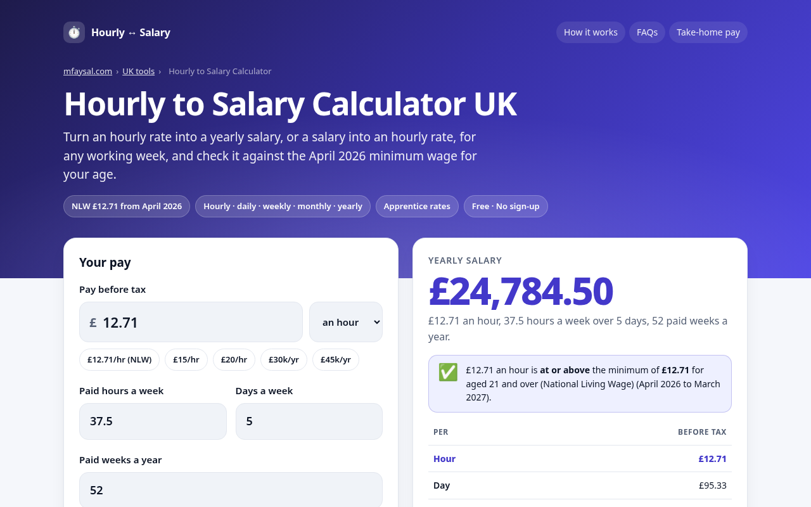

# UK Hourly to Salary Calculator + Minimum Wage Check

**Live:** https://uk-hourly-salary-calculator.vercel.app
**Project page:** https://mfaysal.com/projects/uk-hourly-salary-calculator

Convert **hourly pay to a yearly salary** (or any period to any other) for your own working week, and check it against the **National Minimum Wage and National Living Wage from 1 April 2026**: £12.71 (21+), £10.85 (18–20), £8.00 (under 18 and apprentices).



## Features
- Hourly, daily, weekly, monthly and yearly pay from any one of them
- Custom hours a week, days a week and paid weeks a year
- Minimum wage check by age, apprentice status and first year, for April 2024, 2025 and 2026 rates
- Shortfall per year if you’re paid below the minimum
- One click through to the take-home pay calculator with your salary
- Shareable URLs (`?pay=15&h=40&age=20`), copy result
- Accessible (labels, keyboard, live regions), dark mode, no tracking, no cookies, no API keys
- SEO: canonical, Open Graph/Twitter card, `WebApplication` + `FAQPage` + `BreadcrumbList` JSON-LD, sitemap, robots.txt

## Tech
Plain HTML, CSS and JavaScript (ES modules), no build step and no dependencies. The calculation lives in [`public/wage.js`](public/wage.js) and is unit-tested (11 tests):

```bash
npm test   # node --test
```

| Test case | |
|---|---|
| April 2026 rates from GOV.UK: £12.71, £10.85, £8, £8 | ✅ |
| Rates switch on 1 April | ✅ |
| GOV.UK apprentice examples: 21 in first year = £8, after first year = £12.71 | ✅ |
| Age groups | ✅ |
| £12.71 an hour, 37.5 hours, 52 weeks = £24,784.50 a year | ✅ |
| £30,000 a year at 37.5 hours = £15.38 an hour | ✅ |
| £2,000 a month at 40 hours = £11.54 an hour | ✅ |
| Day rate × days × weeks | ✅ |
| Below minimum wage is flagged with the shortfall | ✅ |
| Exactly the minimum passes | ✅ |
| Full-time salary at the National Living Wage | ✅ |

## Sources (checked 8 October 2026)
- [GOV.UK: National Minimum Wage and National Living Wage rates](https://www.gov.uk/national-minimum-wage-rates)
- [GOV.UK: Am I getting the minimum wage?](https://www.gov.uk/am-i-getting-minimum-wage)

> **Disclaimer:** conversions assume the same hours every week; minimum wage rules have exceptions this tool can’t check. Use the GOV.UK checker or contact Acas if unsure.

## Author
Built by **[Mahir Faysal](https://mfaysal.com)**, a web developer making free tools for the UK and Bangladesh.
- Website and blog: [mfaysal.com](https://mfaysal.com)
- All free tools: [mfaysal.com/uk-tools](https://mfaysal.com/uk-tools)
- Also try the [Take-Home Pay Calculator](https://take-home-pay-calculator-uk.vercel.app), [Energy Running Cost Calculator](https://uk-energy-cost-calculator.vercel.app), [Redundancy Pay Calculator](https://uk-redundancy-pay-calculator.vercel.app) and [Holiday Entitlement Calculator](https://uk-holiday-entitlement-calculator.vercel.app), plus Bangladesh tools: [Bangladesh Income Tax Calculator](https://bangladesh-income-tax-calculator.vercel.app), [Electricity Bill Calculator](https://bangladesh-electricity-bill-calculator.vercel.app) and [bKash, Nagad & Rocket Charge Calculator](https://bkash-nagad-rocket-charge-calculator.vercel.app)

MIT licensed.
